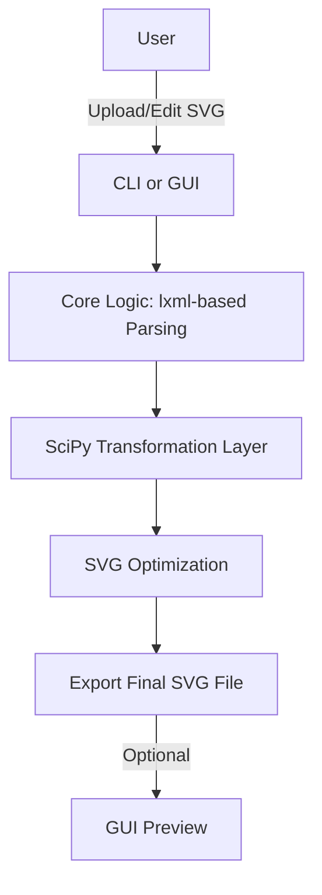

# SVG Editor    

## Executive Summary
**SVG Editor** is a lightweight and efficient Python-based suite designed to streamline SVG file manipulation. By combining powerful libraries like `lxml` and `SciPy`, it offers developers innovative tools for SVG optimization while enabling extensibility for broader accessibility.

---

## Key Features
- **Efficient SVG optimization:** Analyze and reduce file size without compromising visual quality.
- **Advanced parsing with `lxml`:** Seamless parsing and manipulation of complex XML-based SVG files.
- **Geometric transformations:** Leverage `SciPy` for precise scaling, rotation, and coordinate transformations.
- **Customizability:** Modular functions for tailored SVG operations.
- **Future-Ready:** Plans for a **Graphical User Interface (GUI)**, enhancing usability and adoption potential.

---

## Architecture & Workflow

Below is a high-level overview of the system's existing architecture and planned GUI implementation:



---

## Tech Stack & Tools Breakdown
| Technology/Tool | Purpose                                   |
|------------------|-------------------------------------------|
| **Python**       | Primary programming language             |
| **lxml**         | Fast and threaded XML parsing            |
| **SciPy**        | Advanced geometric manipulation routines |
| **shields.io**   | Dynamic status and project badges        |
| **Tkinter (Planned)** | Intuitive graphical interface library |

---

## Quickstart / Installation

Follow these steps to get started with **SVG Editor**:

1. **Clone the repository**:
   ```bash
   git clone https://github.com/EF361/svg_editor.git
   cd svg_editor
   ```

2. **Set up a virtual environment** (recommended):
   ```bash
   python3 -m venv venv
   source venv/bin/activate   # On Windows: venv\Scripts\activate
   ```

3. **Install dependencies**:
   ```bash
   pip install -r requirements.txt
   ```

4. **Run the CLI tool** to edit or optimize your SVG:
   ```bash
   python main.py --help
   ```

5. (**Coming Soon**) **GUI Mode**:
   The upcoming GUI would supplement CLI functionality, offering an intuitive canvas for file editing.

---

Invest your time into **SVG Editor** to streamline your SVG workflow while scaling your projects with ease and efficiency. 🚀 Contributions and feedback welcome—let's evolve this project together!