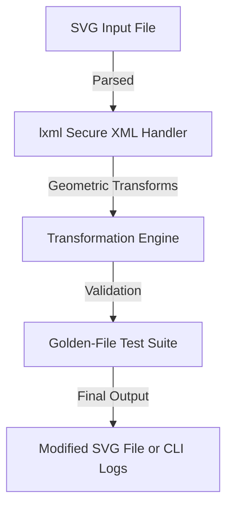

# SVG Editor


## Executive Summary

**SVG Editor** is a Python-powered tool designed to provide robust SVG parsing, geometric transformations, and CLI-based file manipulation. It empowers users to process and refine SVG graphics programmatically while prioritizing security and rendering accuracy.

---

## Key Features

- **Secure SVG Parsing**: Built with `lxml` utilizing secure XML parser settings to prevent external-entity attacks and mitigate risks from malformed documents.
- **Geometric Transformations**: Supports basic affine transformations (e.g., scaling, translation, rotation) for SVG elements, with a focus on performance and precision.
- **CLI Tooling**: Command-line interface for streamlined SVG input-processing-output workflows, complete with example usage and expected behavior for malformed inputs.
- **Namespace & Style Support**: Manage standard SVG namespaces and CSS inline styles for consistent rendering.
- **Golden-File Tests**: Ensures semantic rendering fidelity by comparing output against pre-validated "golden files."
- **Roadmap Features**: Planned GUI built with `Tkinter` and advanced SVG optimization techniques, clearly demarcated as future iterations.

---

## Architecture & Workflow



---

## Tech Stack & Tools Breakdown

- **Python 3.9+**: Core programming language.
- **lxml**: Powering XML parsing with a focus on secure processing.
- **SciPy (Evaluation Ongoing)**: Used for mathematical operations in geometric transformations (subject to revision for lighter dependencies).
- **Tkinter (Planned)**: Proposed GUI framework for an interactive SVG editing interface.

---

## Quickstart / Installation

### Prerequisites
- Python 3.9 or later
- Virtual environment tool (e.g., `venv` or `virtualenv`)

### Installation Steps
1. Clone the repository:
    ```bash
    git clone https://github.com/EF361/svg_editor.git
    cd svg_editor
    ```

2. Create and activate a virtual environment:
    ```bash
    python3 -m venv venv
    source venv/bin/activate  # On Windows: venv\Scripts\activate
    ```

3. Install dependencies:
    ```bash
    pip install -r requirements.txt
    ```

4. Run the CLI script to process an SVG file:
    ```bash
    python svg_editor.py --input example.svg --output output.svg --transform rotate,90
    ```

---

## Command-Line Interface (CLI) Examples

### Standard Use Case
```bash
python svg_editor.py --input input.svg --output output.svg --transform scale,2
# Description: Scales all SVG elements by a factor of 2.
# Expected Exit Code: 0
```

### Malformed Input Example
```bash
python svg_editor.py --input invalid.svg --output output.svg
# Description: Processes an invalid SVG file.
# Expected Exit Code: 1 (Error: "Invalid XML structure.")
```

### Help/Usage Information
```bash
python svg_editor.py --help
# Displays all available commands and usage details.
```

---

## Supported SVG Features

### Elements
- `<rect>`, `<circle>`, `<ellipse>`, `<path>`, `<line>`, `<polygon>`, `<polyline>`

### Path Commands
- `M`, `L`, `H`, `V`, `C`, `S`, `Q`, `T`, `A`, `Z`

### Transforms
- `translate(x, y)`, `scale(x, y)`, `rotate(angle)`, `skewX(angle)`, `skewY(angle)`

### Namespaces
- `http://www.w3.org/2000/svg`

### CSS Styles
- Inline styles for `fill`, `stroke`, `stroke-width`, `opacity`, etc.

---

## Roadmap

1. **Graphical User Interface (GUI)**: Develop an interactive editor using `Tkinter`.
2. **SVG Optimization Features**: Implement advanced algorithms for path simplification and file size reduction.
3. **SciPy Dependency Review**: Evaluate and potentially replace `SciPy` with a lighter library for basic numerical operations.

---

## License

This project is licensed under the MIT License. See the `LICENSE` file for details.

--- 

**Contributors:** Alicia Goh (EF361)