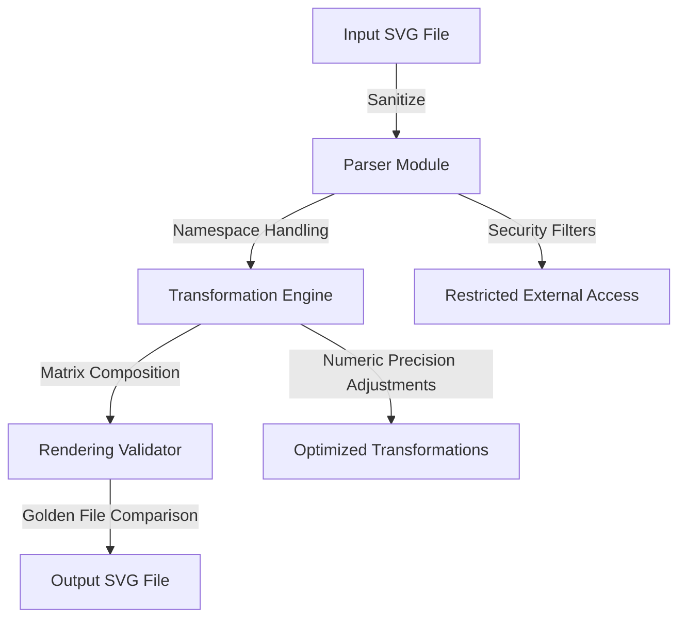

# SVG Editor  
[](https://www.python.org/)  
[](./LICENSE)  
[]()  
[]()  

## Executive Summary  
**SVG Editor** is a secure and extensible Python-based toolkit for transforming and editing SVG files. It provides robust CLI and GUI support for scalable transformations, styling, and sanitization while adhering to the highest security and performance standards.

## Key Features  
- **Security-First Parsing**: Configures `lxml` to disable entity resolution, DTD loading, and oversized-tree parsing.  
- **SVG Sanitization**: Strips or neutralizes potentially dangerous elements (e.g., `<script>`, event handlers, `foreignObject`).  
- **Transformations via Matrix Composition**: Implements flexible affine transformations, supporting nested transforms, arcs, and scaling issues.  
- **Namespace and ViewBox Handling**: Properly manages SVG namespaces and delves into precise behavior of `viewBox`.  
- **Golden Rendering Comparisons**: Ensures output consistency by validating SVG renderings against golden files.  
- **Comprehensive CLI**: Batch process SVG files with chainable transformations directly from the command line.  
- **Lightweight Dependency Footprint**: Transitioning from `SciPy` to custom affine matrix operations for enhanced efficiency.  
- **Testing and Validation**: Property-based testing, parser fuzzing, and numerical precision validation to ensure robust handling of edge cases.  

---

## Architecture & Workflow  


### Workflow Breakdown
1. **Input SVG File**: Accept external SVG files via CLI or GUI.  
2. **Parser Module**: Sanitize and parse SVG input with `lxml` using secure configurations.  
3. **Transformation Engine**: Apply affine transformations via matrix composition.  
4. **Rendering Validator**: Compare final output against golden rendering files.  
5. **Output SVG File**: Safely export optimized and sanitized SVG.

---

## Tech Stack & Tools  
- **Programming Language**: Python 3.9+  
- **Libraries**:  
  - `lxml` for secure XML/SVG parsing.  
  - `Tkinter` for GUI rendering components.  
  - Custom affine transformation logic (transitioning away from `SciPy`).  
- **Testing**: Parser fuzzing, property-based tests, and rendering validations.  

---

## Quickstart / Installation  

### Prerequisites  
- Python 3.9 or later installed on your system.  

### Installation  
```bash
# Clone the repository
git clone https://github.com/username/svg_editor.git
cd svg_editor

# Create and activate a virtual environment
python -m venv venv
source venv/bin/activate  # On Windows, use `venv\Scripts\activate`

# Install dependencies
pip install -r requirements.txt
```

### Basic Usage: CLI  
```bash
# Syntax: svg_editor.py --input <input_file> --output <output_file> --transform <transformation>
python svg_editor.py --input example.svg --output output.svg --transform rotate(45)
```

### Basic Usage: GUI  
```bash
python svg_editor.py --gui
```

---

## Planned Features  
- Native support for SVG animations.  
- Support for advanced styling operations.  
- Cloud-based integration for large-scale batch processing.  
- Optimized libraries for even larger SVG datasets.  

---

## Contributing  
We welcome contributions! Please review our [Contribution Guidelines](./CONTRIBUTING.md) and submit a pull request.  

---

## License  
This project is licensed under the MIT License. See the [LICENSE](./LICENSE) file for details.  

--- 
_Project maintained by Alicia Goh (EF361), Senior Software Engineer._