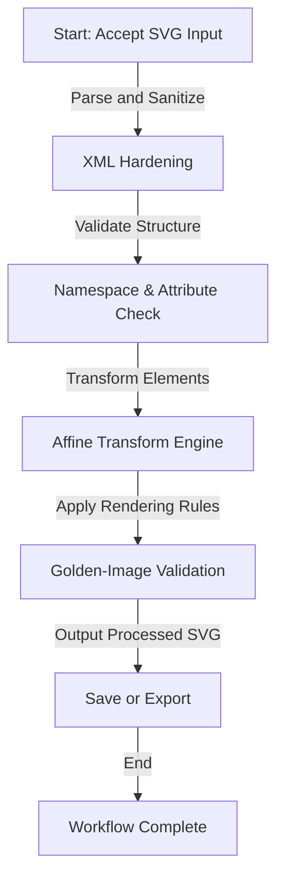

# SVG Editor   

## Executive Summary
`svg_editor` is a Python-based tool designed to process, sanitize, and transform SVG files with efficient, secure, and precise handling of affine matrix operations, XML parsing, and rendering tests. The project addresses critical security and functionality challenges in SVG manipulation, offering a robust platform for developers and creators working with scalable vector graphics.

---

## Key Features

### Implemented
- **Secure XML Parsing**: Hardened against adversarial and oversized inputs using `lxml` with an allowlist sanitizer.
- **Active Content Removal**: Ensures safety by blocking URL-bearing attributes, CSS, external references, and data URLs.
- **Affine Matrix Transformations**: Custom model with property tests for composition, inversion, and nested groups.
- **Rendering Validation**: Golden-image generation and cross-platform regression testing with defined precision tolerances.
- **CLI Tool**: Interactive and scriptable interface for SVG transformations.
- **Fuzz Testing**: Automated parser fuzzing within time and memory limits to detect edge cases.

### Experimental
- **ViewBox Semantics**: Enhanced handling of scaling and coordinate transformations.
- **Arcs and Curves Precision**: Testing precision tolerances for complex path elements.
- **Reproducible Rendering Engine**: Early modeling of platform-agnostic rendering policies.

### Planned
- **Deep Namespace Handling**: Improved support for custom namespaces in SVG files.
- **Extended Testing**: Adversarial examples with deeply nested elements and extreme scenarios.
- **Interactive GUI**: Tkinter-based graphical interface for more accessible SVG editing.

---

## Architecture & Workflow



---

## Tech Stack & Tools Breakdown

- **Language**: Python 3.9+
- **Libraries**:
  - `lxml` for XML parsing and sanitization
  - Custom affine matrix operations for geometrical transformations
  - Tkinter (planned) for GUI-based editing
- **Testing**:
  - Property-based testing to validate affine matrix composition and nested effects
  - Fuzz testing for XML parser robustness
  - Golden-image testing for rendering accuracy across platforms
- **Command-Line Interface**:
  - Built-in CLI for interactive or batch SVG processing

---

## Quickstart / Installation

### Prerequisites
- Python 3.9 or later
- `pip` package manager

### Installation
```bash
# Clone the repository
git clone https://github.com/EF361/svg_editor.git
cd svg_editor

# Set up a virtual environment (recommended)
python3 -m venv venv
source venv/bin/activate  # On Windows: venv\Scripts\activate

# Install dependencies
pip install -r requirements.txt
```

### Usage
```bash
# Display help
python svg_editor.py --help

# Process an SVG file
python svg_editor.py --input "example.svg" --output "output.svg" --transform "scale=2,rotate=45"

# Run tests
pytest tests/
```

---

## Contribution Guidelines
We welcome contributions! Please adhere to the following:
1. Fork the repository and create a feature branch.
2. Ensure all tests pass locally before submitting a pull request.
3. Document your changes in both code comments and the README if applicable.

---

## License
This project is licensed under the **MIT License**. See the `LICENSE` file for details.

---

## About
Developed by **Alicia Goh (EF361)**, this SVG editor demonstrates expertise in Python development, secure XML handling, and end-to-end software testing. Contributions and feedback are warmly welcomed!